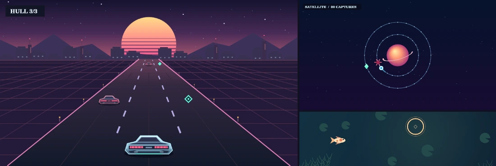

# SideQuest

**A little arcade for the moments you’re waiting on ChatGPT.**

Send a message, pick up a game, and return when your reply is ready. SideQuest opens inside your chat, with 50 short games to discover.

[Download SideQuest](https://github.com/MattC-bit/sidequest-arcade/archive/refs/heads/main.zip) · [Installation](#install-on-a-computer) · [Privacy](#what-sidequest-can-see) · [FAQ](#frequently-asked-questions)

## How it works

1. **Send a message.** If ChatGPT is still generating after about 5½ seconds, SideQuest offers a game.
2. **Play while you wait.** Start a random game immediately or browse the library. Your choice is remembered.
3. **Return when you're ready.** When SideQuest detects the reply has finished, the game pauses. Return to chat or keep playing.

The arcade floats over your conversation. Move it, resize it, or switch to full screen. SideQuest remembers your window size and position.

> Invitations depend on the controls ChatGPT displays. Quick replies may finish before the invitation appears, and some ChatGPT layouts or languages may behave differently.

## Install on a computer

Use **Google Chrome** on a computer, or another desktop browser that can load Chrome extensions, such as **Microsoft Edge** or **Brave**. Open ChatGPT in that browser. SideQuest works from a folder on your computer. Installation takes a few clicks and requires no terminal commands.

1. **Download and unzip SideQuest.** Click the green **Code** button on this page, then **Download ZIP**. On Windows, right-click it and choose **Extract All**. On Mac, double-click it. Move the extracted files somewhere you can keep them, such as your Documents folder.
2. **Open your browser’s extensions page.** In the address bar, type `chrome://extensions` (Chrome), `edge://extensions` (Edge), or `brave://extensions` (Brave), then press Enter.
3. **Turn on Developer mode** at the top of that page. Click **Load unpacked**. In the folder picker, open the extracted files and select the folder named **SideQuest**. To recognize the right folder, look inside for a file called **manifest.json**. Select the folder itself.
4. **Refresh your ChatGPT tab.** To check the installation immediately, open the browser’s **Extensions** menu near the address bar, click **SideQuest**, then **Open arcade**. Pin the lightning icon if you’d like a shortcut.

The downloaded folder includes the source and an offline guide alongside the extension. Keep the folder in place after installing.

## Explore the arcade

- **50 short games** across four collections, with rounds of up to 35 seconds.
- **Save favorites** with the ☆ beside Pause. Find them later under **Saved**.
- **Try another game** with the dice button after a round, or choose **Play again** to replay the same one.
- **Browse at your pace** by clearing **Play a random game** on the invitation. SideQuest remembers your choice and features a different game each time you open the library.

You can dismiss an invitation or snooze it. To open the arcade yourself, click the SideQuest toolbar icon and choose **Open arcade**.

### Make the game window yours

| To… | Do this |
| --- | --- |
| Move the window | Drag the **Move arcade** handle along the top. |
| Make it bigger or smaller | Drag either triangular lower corner. From the default upper-right position, drag the **lower-left** corner down and left to grow into the page. |
| Adjust it with a keyboard | Tab to **Move arcade**. Use arrow keys to move and **Shift + arrow keys** to resize. |
| Start in full screen | Open the SideQuest toolbar icon and select **Full screen** under **Game window**. **Expand** also enlarges the current round. |
| Restore the original layout | Click **Reset window** in the floating title bar, or **Reset floating window** in the toolbar. This restores the default size and upper-right position. |

The floating window remembers its last size and position in this browser profile. If the browser gets smaller, SideQuest fits the window back inside the tab. The reset only affects window placement and size.

## What SideQuest can see

The browser gives SideQuest permission to run on pages at **chatgpt.com**. That is meaningful access: a script on this site can interact with the visible page. This version uses that access to watch controls like Send and Stop, recognize when a new reply has finished, and display the arcade. It compares temporary turn identifiers in memory. It does not read or save the text of prompts or replies, send messages on your behalf, or access your account cookies.

The games, artwork, and sound run locally. SideQuest has no server, analytics, external game downloads, or SideQuest account. Your browser saves your favorites, sound and motion preferences, recently featured games, snooze expiry, launch choices, and four numbers for the floating window’s size and position. This describes the distributed SideQuest code; ChatGPT continues to handle your conversations under its own terms. Use a copy from a publisher you trust.

## Frequently asked questions

**Why did the browser ask for Developer mode?**  
This download is an unpacked extension. Developer mode exposes the **Load unpacked** button so the browser can install it from a folder. Installing the release does not require an API key, payment, or your ChatGPT password.

**I installed it. Why didn’t a game appear?**  
Quick answers often finish before the invitation timer. Refresh an already-open ChatGPT tab once after installing. Keep that tab visible during a longer reply, and check the SideQuest toolbar for a snooze. **Open arcade** is a quick way to check the installation independently of reply detection.

**Does it work in every chat, or in the phone app?**  
It targets ChatGPT conversations on the website, including Chat and Work. Automatic invitations depend on the controls ChatGPT displays. Some layouts, languages, and background tasks may expose different signals. The download is intended for Chrome and other desktop browsers that can load unpacked Chrome extensions. It doesn’t install into the native ChatGPT app.

**What happens when I close the game?**  
**Return to chat** closes the arcade and returns focus to the conversation. **Keep playing** resumes the paused round. Moving to another conversation closes the overlay. Window placement and preferences carry over; a closed round ends.

**How do I play without sound or with a keyboard?**  
Music starts muted. The arcade settings let you adjust music, sound effects, and visual motion. Games show their own controls and support pointer or keyboard input. Try arrow keys, WASD or ZQSD. In supported Signal puzzles, **V** reads the board. Action games rely on the visual playfield.

**How do I update or uninstall?**  
To update, replace the contents of the **same SideQuest folder** with the new version, click **Reload** on the extensions page, then refresh your ChatGPT tabs. Keeping the original folder path helps preserve local preferences. To uninstall, click **Remove** on the SideQuest card on the extensions page, then refresh any open chat tabs. You can delete the extracted folder afterward.

**Can I share or modify it?**  
Yes, for permitted noncommercial purposes under **PolyForm Noncommercial 1.0.0**. Pass along the license or its URL and applicable notices. The same terms cover the bundled artwork and icons. Commercial licensing requires separate permission. [Official license terms](https://polyformproject.org/licenses/noncommercial/1.0.0)

**How do I report a bug without sharing my chat?**  
Use the repository’s Issues tab. Include the SideQuest and browser versions, Chat or Work mode, what you clicked, and what you expected. A fictional prompt is enough. If you add an image, crop it to the extension and remove names, conversation text, and private URLs.

SideQuest is an independent project. It is unaffiliated with OpenAI.
